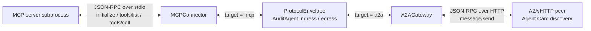
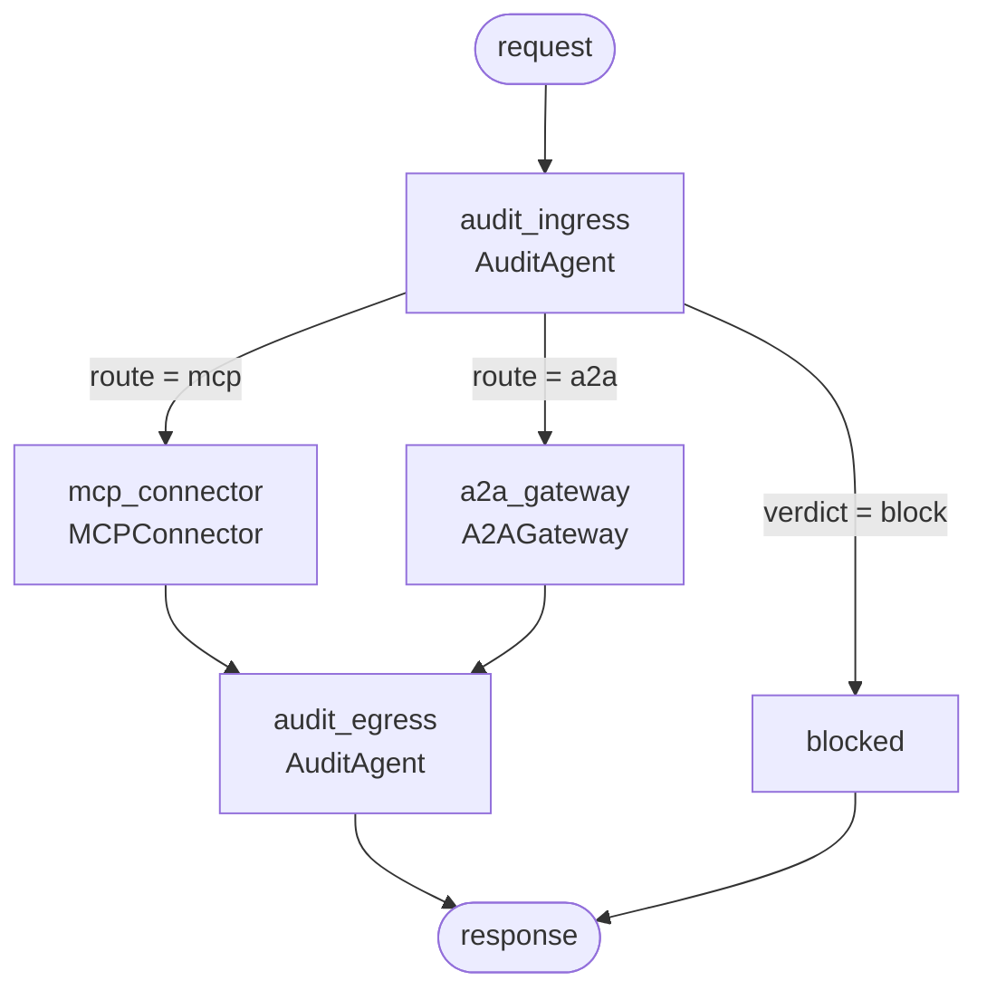

# ProtoBridge

[](https://github.com/asadullah48/protobridge/actions/workflows/tests.yml)

**The problem:** MCP tools and A2A agents speak different protocols; ProtoBridge routes both through one audited `ProtocolEnvelope` pipeline.

A local reference implementation using **synthetic data**, not a production product.

## Demo

> **TODO:** Add a demo recording.

## Run it

From the repo root, with [uv](https://docs.astral.sh/uv/) installed:

```bash
uv run --extra dev protobridge demo --llm deterministic
```

This starts a local A2A HTTP peer on an ephemeral port and an MCP server
subprocess. It makes real JSON-RPC `initialize`, `tools/list` and `tools/call`
requests over stdio, then A2A `message/send` requests over HTTP. Both routes
use the audit pipeline. The command stops both peers when it finishes.
All tools, people, vendors, rates and agent responses are **synthetic fixtures**;
no external service or API key is needed.

**VERIFIED, 31 Oct 2026:** The command above exited successfully. Full console
output follows, exactly as printed by the CLI (which caps content at 200
characters). Ports, timestamps, latency and ledger hashes vary between runs.

<details>
<summary>Full output of that run (the port, timestamps and ledger head change every run)</summary>

```
------------------------------------------------------------------------
ProtoBridge 0.1.0 - MCP + A2A interoperability demo
  MCP protocol : 2025-06-18 (stdio, subprocess)
  A2A protocol : 0.3.0 (http, ephemeral port)
  reasoner     : deterministic
------------------------------------------------------------------------

discovered A2A peer: Northwind Vendor Risk Agent @ http://127.0.0.1:61250
  skills: vendor.risk_assessment, supply.lead_time_estimate
discovered MCP tools: fx.convert, kb.search, hr.employee_lookup

[1] MCP tool call, fully permitted
    route     : mcp
    verdict   : allow
    findings  : none
    content   : {"amount": 250.0, "from": "USD", "to": "PKR", "rate": 278.5, "converted": 69625.0}
    latency   : 0.3 ms
    narrative : MCP call to 'fx.convert' completed cleanly; no policy findings.

[2] MCP tool returning PII, caller under-cleared -> redaction
    route     : mcp
    verdict   : redact
    findings  : SEC-001(high)
    redacted  : email, national_id, salary_band
    content   : {"record": {"employee_id": "E-1001", "name": "Ada Lovelace", "email": "[REDACTED]", "national_id": "[REDACTED]", "salary_band": "[REDACTED]", "department": "Platform Engineering"}}
    latency   : 0.2 ms
    narrative : MCP call to 'hr.employee_lookup' was allowed after redacting sensitive fields. 1 finding(s) [SEC-001]; most severe high: response exposes PII fields ['email', 'national_id', 'salary_band'] at classification restricted, above principal clearance internal Remediation: redact the fields or raise the principal's clearance.

[3] MCP tool outside the caller's allowlist -> blocked at ingress
    route     : blocked
    verdict   : block
    findings  : GOV-001(high)
    error     : blocked at ingress by AuditAgent: GOV-001
    latency   : 0.0 ms
    narrative : MCP call to 'hr.employee_lookup' was blocked. 1 finding(s) [GOV-001]; most severe high: role 'planner' is not permitted to invoke tool 'hr.employee_lookup' Remediation: add the tool to ROLE_TOOL_ALLOWLIST or use a privileged role.

[4] A2A delegation to a cross-vendor agent
    route     : a2a
    verdict   : allow
    findings  : none
    content   : {"skill": "vendor.risk_assessment", "vendor": "globex-freight", "risk_score": 0.58, "tier": "medium", "assessed_at": "2026-10-31T05:49:30.497262+00:00"}
    latency   : 2.7 ms
    narrative : A2A call to 'vendor.risk_assessment' completed cleanly; no policy findings.

[5] A2A delegation carrying restricted data across a vendor boundary
    route     : blocked
    verdict   : block
    findings  : SEC-002(critical)
    error     : blocked at ingress by AuditAgent: SEC-002
    latency   : 0.0 ms
    narrative : A2A call to 'vendor.risk_assessment' was blocked. 1 finding(s) [SEC-002]; most severe critical: restricted-classification payload is being sent to an agent operated by another vendor Remediation: execute a data processing addendum or downgrade the payload.

[6] A2A delegation to a second declared skill
    route     : a2a
    verdict   : allow
    findings  : none
    content   : {"skill": "supply.lead_time_estimate", "vendor": "acme-logistics", "lead_time_days": 12, "assessed_at": "2026-10-31T05:49:30.503122+00:00"}
    latency   : 2.3 ms
    narrative : A2A call to 'supply.lead_time_estimate' completed cleanly; no policy findings.

------------------------------------------------------------------------
audit ledger
  entries    : 10
  chain      : INTACT
  head       : ad9c57e9df00c1b50f0adb5bcf2fef8ccb19ccf0c8f9a0853590c6789287934a
------------------------------------------------------------------------
```

</details>

## How the protocols connect



Drawn from [the demo](src/protobridge/cli.py),
[connectors](src/protobridge/agents.py), [graph routing](src/protobridge/graph.py),
and the [MCP](src/protobridge/protocols/mcp.py) and
[A2A](src/protobridge/protocols/a2a.py) transports.
The caller creates an envelope; its `target` selects one protocol per call.
An MCP response is not automatically forwarded to the A2A peer.
Ingress can block dispatch; egress checks the returned `EnvelopeResult`.

---

## Overview

**An MCP + A2A interoperability layer for agentic AI systems.**

Speak Anthropic's **Model Context Protocol** and Google's **Agent2Agent**
through one governed pipeline — without the calling code knowing which protocol
is on the other side, and without losing the compliance signal at the boundary.

The bundled demos run locally with no API keys, accounts or cloud egress.

**[▶ Interactive demo (static, GitHub Pages)](https://asadullah48.github.io/protobridge/)** — inspect real traces and verify the
audit chain with SHA-256 in your own browser.

*[العربية](./README.ar.md) · [Full specification](./SPEC.md) · [Portfolio](https://asadullahshafique-devunity.vercel.app)*

---

## Why this matters for enterprises

Most agent platforms pick one protocol and strand themselves. The ones that
adopt both usually bolt them together with point-to-point glue, and quietly lose
the things auditors ask about.

| Enterprise concern | What ProtoBridge does |
|---|---|
| **Vendor lock-in** | One `ProtocolEnvelope` abstracts both protocols. Swapping an MCP tool for an A2A peer is a routing change, not a rewrite. |
| **Integration cost** | Adding a protocol costs **2N** work (one codec pair), not **N²** point-to-point translators. |
| **Data residency & PII** | Sensitivity labels ride inside the message, so a response carrying a national id is caught and redacted *at the boundary* — not discovered in a log review. |
| **Third-party risk** | Cross-vendor delegation is a first-class, checkable condition. Restricted data crossing a vendor boundary is refused by policy, and the peer refuses it independently too. |
| **Auditability** | Every hop lands in a hash-chained ledger. Tampering is detectable and locatable, and the chain head is publishable as external proof. |
| **Traceability** | One `trace_id` correlates an MCP tool call with the A2A delegation it triggered — verified on the way back, not assumed. |
| **Protocol drift** | Unsupported protocol versions are refused rather than silently downgraded. |

---

## Quickstart

```bash
git clone https://github.com/asadullah48/protobridge.git
cd protobridge
uv sync --extra dev
uv run protobridge demo
```

That runs six scenarios against a **real MCP server in a subprocess** and a
**real A2A agent over HTTP** — allow, redact, and block paths — then verifies
the audit chain. Abridged output:

```
[2] MCP tool returning PII, caller under-cleared -> redaction
    route     : mcp
    verdict   : redact
    findings  : SEC-001(high)
    redacted  : email, national_id, salary_band
    content   : {"record": {"name": "Ada Lovelace", "email": "[REDACTED]", ...}}

[5] A2A delegation carrying restricted data across a vendor boundary
    route     : blocked
    verdict   : block
    findings  : SEC-002(critical)
    error     : blocked at ingress by AuditAgent: SEC-002

audit ledger
  entries    : 10
  chain      : INTACT
  head       : 147240e3a09c6cb3...
```

---

## Commands

| Command | What it does |
|---|---|
| `protobridge demo` | Full interoperability scenario, offline |
| `protobridge demo --ledger-out audit.jsonl` | Same, exporting the audit chain as JSON Lines |
| `protobridge audit` | Runs the scenario, then proves tampering is detected and located |
| `protobridge graph` | Prints the agent graph as mermaid |
| `protobridge card` | Prints the reference A2A Agent Card |
| `protobridge tools` | Prints the reference MCP tool catalogue |
| `protobridge serve-mcp` | Runs the reference MCP server on stdio |
| `protobridge serve-a2a --port 8931` | Runs the reference A2A agent over HTTP |

Point any MCP client at `uv run protobridge serve-mcp`, or `curl` the Agent Card:

```bash
uv run protobridge serve-a2a &
curl -s http://127.0.0.1:8931/.well-known/agent.json
```

---

## The three agents



- **MCPConnector** — integrates external APIs and tools over MCP (JSON-RPC on
  stdio). Holds one session open across calls, since `initialize` is
  per-connection rather than per-invocation.
- **A2AGateway** — enables cross-vendor agent communication over A2A (JSON-RPC
  on HTTP). Discovers peers by Agent Card and delegates work as tasks the peer
  is free to refuse.
- **AuditAgent** — monitors compliance and protocol adherence. Runs **twice per
  hop**: admission control before dispatch, egress control after.

Note there is no edge from `START` into a connector. The audit is structural —
you cannot forget to call it.

---

## Twenty CRM adapter as governed tools (tested on offline fixtures)

Synthetic fixtures only prove so much, so ProtoBridge ships an adapter for
[Twenty](https://twenty.com), the open-source CRM. Contacts, companies, deals
and notes become MCP tools routed through the same audit, redaction and
allowlist layer:

```bash
uv run protobridge crm          # offline fixture, no keys needed
uv run protobridge crm-tools    # the CRM tool catalogue
uv run protobridge serve-crm    # point any MCP client at the CRM
```

Real output:

```
[1] Contact lookup by an under-cleared caller
    verdict   : redact
    findings  : SEC-001(high)
    redacted  : city, primaryEmail, primaryPhoneNumber

[4] Writing a note with a read-only role -> blocked
    verdict   : block
    findings  : GOV-001(high), GOV-003(critical)

[5] Same write by a role holding write permission
    verdict   : allow
```

**The egress integration needed no new rule.** The rules already walk *field
names* rather than value patterns, so unioning Twenty's PII field names into
`ALL_PII_FIELDS` was the entire change — a person record became governed the
moment its field names were known.

**The write path did need one.** Every tool before the CRM was read-only, so
"allowlisted" and "may read" were the same thing. They stop being the same
thing once a tool can mutate a live customer record, so write permission is a
separate grant (`ROLE_WRITE_PERMISSION`) enforced by rule `GOV-003` at
`critical` severity. Collapsing the two would let a read grant silently become
a write grant.

### Pointing it at a real workspace

```bash
export TWENTY_BASE_URL=https://crm.example.com
export TWENTY_API_KEY=...          # Settings -> API & Webhooks
uv run protobridge crm
```

With neither variable set the adapter uses a deterministic offline fixture, so
the zero-key promise above still holds on a fresh clone.

---

## Design decisions worth knowing

**One pivot type, not N² translators.** Every message is lifted into a
`ProtocolEnvelope` and lowered into the target protocol.

**Governance rides inside the message.** Trace ids and classification labels are
envelope fields, not transport headers — headers do not survive an MCP stdio hop.

**Protocols are extended, never forked.** Labels travel in MCP's reserved `_meta`
and A2A's `metadata`, so a stock client on the other end still interoperates.

**Classification-aware egress.** Known PII fields are redacted for under-cleared
callers; above-clearance documents without recognized PII fields are blocked.
The decision remains in the policy seam.

**Two audit phases, because they see different things.** Ingress cannot know a
response will carry a national id; egress cannot un-send a request.

**Reasoning is never load-bearing.** The reasoner writes the human-readable
narrative and nothing else. It cannot change a verdict, which is what makes the
offline default honest.

**One policy seam.** Rules report facts; `rules.decide_verdict()` decides what to
do about them. It is marked `=== POLICY SEAM ===` and is the single function to
edit when your organization's risk posture differs from the default.

---

## Optional local narration

The default reasoner is deterministic and needs nothing. To get
natural-language audit summaries from a model you run yourself:

```bash
ollama serve && ollama pull llama3.2
PROTOBRIDGE_LLM=ollama uv run protobridge demo
```

| Variable | Default | Purpose |
|---|---|---|
| `PROTOBRIDGE_LLM` | `deterministic` | `deterministic` or `ollama` |
| `PROTOBRIDGE_MODEL` | `llama3.2` | Local model name |
| `PROTOBRIDGE_OLLAMA_URL` | `http://127.0.0.1:11434` | Local Ollama endpoint |

If the daemon is down or the model is missing, narration degrades to the
deterministic reasoner. It never breaks the bridge.

---

## Development

```bash
uv run pytest -q       # 65 tests passing (verified 24 Oct 2026, commit 3449d8d)
uv run ruff check .
uv run ruff format .
```

The MCP suite is parametrized over **both** transports — an in-process
dispatcher and a real stdio subprocess — so tests stay fast without letting the
wire path go unexercised.

---

## Project layout

```
src/protobridge/
  envelope.py            ProtocolEnvelope — the pivot type
  protocols/
    jsonrpc.py           shared JSON-RPC 2.0 framing + dispatcher
    mcp.py               MCP types, reference server, stdio client
    a2a.py               A2A Agent Card, HTTP server, client
  agents.py              MCPConnector, A2AGateway, AuditAgent
  rules.py               compliance rules + the policy seam
  ledger.py              hash-chained audit ledger
  graph.py               LangGraph wiring
  llm.py                 pluggable narration (offline by default)
  crm.py                 Twenty CRM adapter — contacts/companies/deals as governed MCP tools
  cli.py                 command-line entry point
```

---

## Limits / non-goals

This is a **reference implementation**, and the boundaries are deliberate:

- The MCP and A2A implementations cover the operations exercised by the reference
  peers and tests; this is not a full protocol conformance certification.
- Principals, clearances and vendor-boundary flags are supplied by the caller;
  deployments must bind these to authenticated identities.
- PII redaction matches configured field names, not arbitrary sensitive text.
  Above-clearance responses without recognized PII fields are blocked because
  field redaction cannot sanitize them. For PII-bearing responses, the remaining
  fields are assumed safe by the reference policy.
- Twenty integration is verified against offline fixtures, not a live customer
  workspace. Workspace-specific schemas need deployment validation.
- Hash chaining detects edits relative to a trusted chain head. An attacker who
  can rewrite the entire ledger can recompute it; retain the head independently.

Infrastructure non-goals: authentication, TLS, rate limiting and durable storage.
The A2A server uses `http.server`; the ledger is in memory with JSON Lines export.
Streaming is unsupported and declared as such in the Agent Card. Bundled tool
and skill fixtures are synthetic; Twenty credentials connect to a real workspace.

See [SPEC.md](./SPEC.md) §12 for the full list.

## 🤖 Agentic AI Alignment

- **Autonomy** — the `ProtocolEnvelope` abstraction lets an MCP tool call
  and an A2A delegation flow through one governed pipeline without the
  calling code branching on which protocol is on the other side.
- **Resilience** — sensitivity labels ride inside the message itself, so
  a response carrying restricted data is caught and redacted *at the
  boundary*, and every hop lands in a hash-chained ledger — tampering is
  detectable and locatable, not just theoretically preventable.
- **Adaptivity** — adding a new protocol costs 2N work (one codec pair),
  not N² point-to-point translators, so the system scales to new agent
  ecosystems without a combinatorial integration cost.

### Roadmap

- Add streaming support when a concrete streaming use case needs it.
- Replace the in-memory ledger with a persistent, still-hash-chained
  store for production cross-vendor deployments.

## 🤖 Author

Built by **Asadullah Shafique**.

🔗 Explore my portfolio showcasing Agentic AI projects and real-world applications: [asadullahshafique-devunity.vercel.app](https://asadullahshafique-devunity.vercel.app)

## License

MIT
